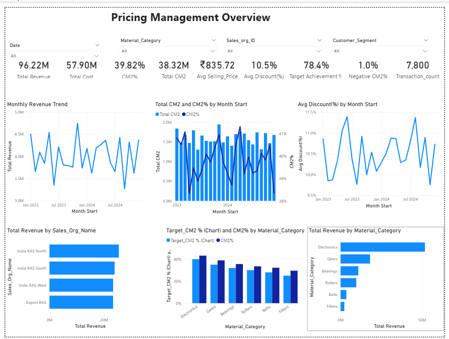
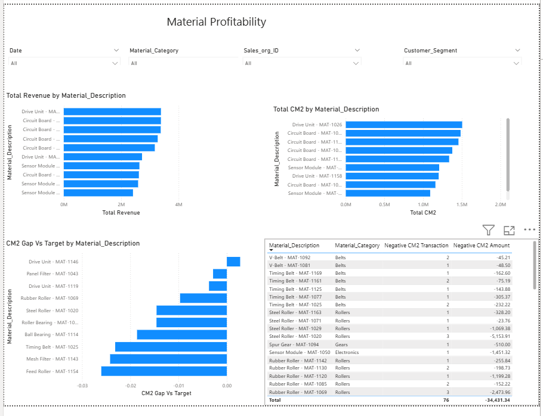
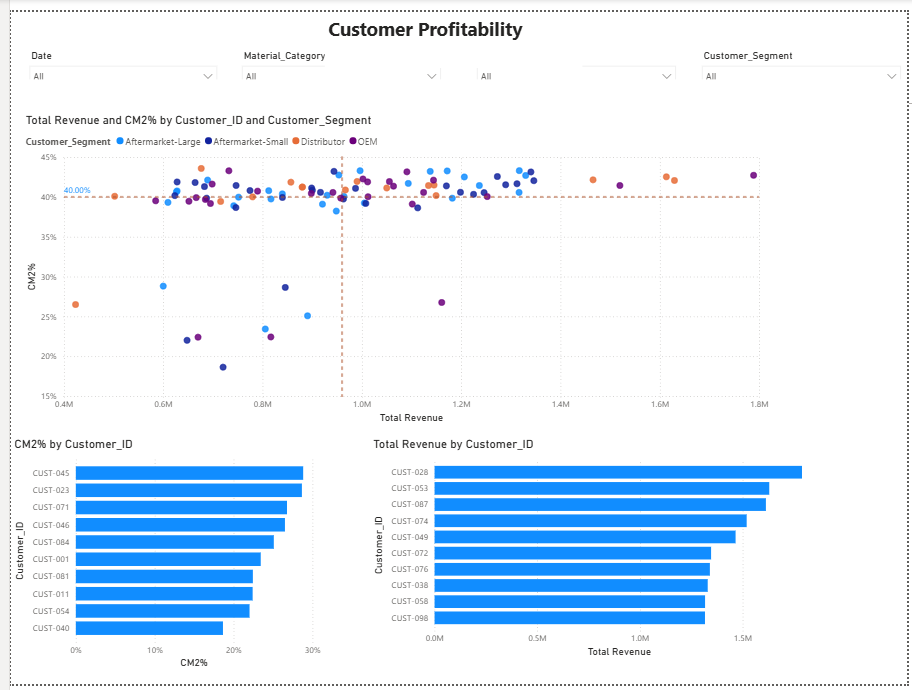
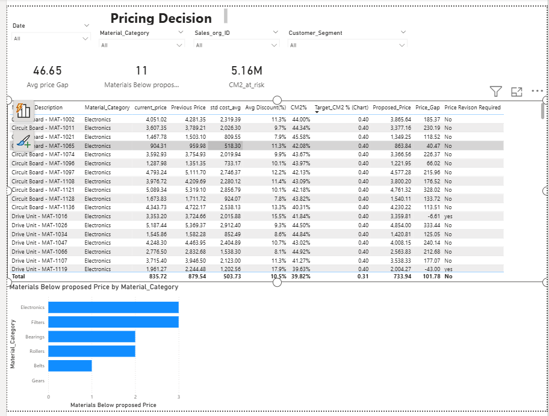

# Industrial Spare Parts Pricing & CM2 Profitability Analytics

An end-to-end analytics project on pricing, discounting, cost and contribution
margin (CM2) for an industrial spare-parts business, built with
**Power BI (DAX), SQL (MySQL) and Python (Pandas, Matplotlib, Seaborn)**.

**Author:** Saurav

---

## About This Project

I work on pricing and profitability analysis in the RAS Department at
Rieter India Pvt. Ltd. This project applies the same kind of thinking, with
CM2, discount tracking and margin erosion, using the tools I have been
teaching myself: Power BI, SQL and Python.

The project is built on a custom dataset I designed, modeled on industrial
spare-parts pricing structures (materials, customers, sales organizations,
standard cost, discounts and CM2). The data files are not published in this
repository. The repository contains the dashboard, the DAX measures, the SQL
queries, the Python analysis scripts and the supporting documentation.

---

## Power BI Dashboard (4 pages)

### 1. Pricing Management Overview


Headline KPIs (revenue, cost, CM2, CM2%, average discount, negative CM2%,
target achievement), monthly revenue, CM2 and discount trends, and breakdowns
by sales organization and material category. Four slicers (date, material
category, sales organization, customer segment) filter every visual.

### 2. Material Profitability


Top 10 materials by revenue and by CM2, the materials furthest below their
category's CM2 target, and a table of loss-making materials with the number of
negative transactions and the CM2 lost.

### 3. Customer Profitability


A customer matrix of revenue against CM2%, coloured by customer segment, with
reference lines at median revenue and at the 40% overall margin. Beneath it
are the lowest-margin customers and the top customers by revenue.

### 4. Pricing Decisions


An action table with one row per material: current price, previous price,
standard cost, discount%, CM2%, target CM2%, proposed price, price gap and a
Yes/No revision flag. KPI cards show the number of materials priced below the
proposed price and the CM2 at risk.

More than 30 DAX measures drive the dashboard, documented in
[`powerbi/dax_measures.txt`](powerbi/dax_measures.txt). Page-by-page build
notes are in [`docs/powerbi_dashboard_spec.md`](docs/powerbi_dashboard_spec.md).

---

## Key Findings

| Metric | Value |
|---|---|
| Total revenue | ₹96.22M |
| Total cost | ₹57.90M |
| Total CM2 | ₹38.32M |
| Overall CM2% | 39.82% |
| Average discount | 10.5% |
| Transactions | 7,800 |
| Transactions meeting category target | 78.4% |
| Loss-making transactions | 76 (1.0%), ₹34,431 of CM2 lost |
| Materials priced below proposed price | 11 of 180 |
| CM2 earned on below-target transactions | ₹5.16M |

- **Margin falls steadily as discount rises.** CM2% declines almost linearly
  with discount and turns negative at roughly 45-50% discount
  (`charts/python_eda/08_discount_vs_cm2_scatter.png`).
- **Category margins are healthy on average.** Every category beats its own
  target, so the margin problem sits in specific materials and customers.
- **A small group of customers drags margin down.** Most customers sit at
  38-44% CM2%, while about ten fall to 19-29%.
- **Loss is small in rupees but widespread below target.** Actual losses
  total ₹34K, but about 22% of transactions fall short of their category
  target. The larger opportunity is discount discipline, not stopping loss
  sales.
- **Revenue is concentrated.** Electronics is the largest revenue category by
  a wide margin.

---

## Data Model

A star schema with two fact tables and six dimensions:

| Table | Purpose |
|---|---|
| `fact_sales` | Transaction-level revenue, cost, CM2 and flags |
| `fact_pricing` | Price and cost change event log |
| `dim_material` | Material master data |
| `dim_customer` | Customer master data |
| `dim_sales_organization` | Sales organization, plant and channel |
| `dim_pricing_condition` | Pricing condition types |
| `dim_category_target` | Category-level target CM2% |
| `dim_date` | Calendar dimension |

```
                         dim_date
                             |
dim_material ──────────► fact_sales ◄────────── dim_customer
                             |
                  dim_sales_organization

dim_material ──────────► fact_pricing ◄────────── dim_date

dim_category_target ──────► fact_sales (via material category)
dim_pricing_condition ──────► fact_sales
```

The table definitions are in [`sql/01_schema.sql`](sql/01_schema.sql).

## Business Logic

| Metric | Formula |
|---|---|
| Revenue | Quantity × Selling Price |
| Cost | Quantity × Standard Cost |
| CM2 (simplified) | Revenue − Cost |
| CM2 % | CM2 / Revenue |
| Discount % | (List Price − Selling Price) / List Price |
| Proposed Price | Standard Cost / (1 − Target CM2%) |

CM2 is simplified to Revenue − Cost for transparency. Real-world CM2
definitions usually include further variable costs such as freight,
commissions and rebates, which are company-specific and not assumed here. The
proposed price is likewise a simplified model. Real pricing also weighs
competitor prices, contracts and currency. See
[`docs/pricing_logic.md`](docs/pricing_logic.md) for the full reference and
the pricing-review tiers.

## Repository Structure

```
├── charts/
│   ├── powerbi_dashboard/       4 dashboard page screenshots
│   └── python_eda/              11 supporting EDA charts
├── powerbi/
│   └── dax_measures.txt         DAX measures and the Month Start column
├── sql/
│   ├── 01_schema.sql            MySQL star schema
│   ├── 02_queries_batch1.sql    Revenue/CM2 trends, top materials, negative CM2
│   ├── 03_queries_batch2.sql    Customer profitability, discount bands, categories
│   └── 04_queries_batch3.sql    Sales org performance, CTEs, window functions
├── python/
│   ├── 01_eda_workflow.py       Cleaning, feature engineering, descriptive stats
│   └── 02_visualizations.py     Matplotlib / Seaborn charts
├── docs/
│   ├── business_questions.md    15 business questions the project answers
│   ├── pricing_logic.md         Formulas, flags and pricing-review tiers
│   └── powerbi_dashboard_spec.md
└── requirements.txt
```

## Tools and Techniques

- **Power BI / DAX:** star-schema modeling, date table, time intelligence
  (`DATEADD`), `CALCULATE` and `SUMX` for conditional measures, Top N
  filters, constant reference lines, conditional formatting.
- **SQL (MySQL):** CTEs, window functions (`RANK`), joins, conditional
  aggregation, `HAVING` versus `WHERE`, 18 analytical queries.
- **Python:** Pandas, NumPy, Matplotlib, Seaborn for cleaning, feature
  engineering, outlier flagging and exploratory analysis. Results were
  cross-checked against the Power BI totals.

## Running the Python Scripts

The scripts expect CSV files that match the schema in `sql/01_schema.sql`,
placed in a `data/` folder next to `python/`. The dataset itself is not
included in this repository.

```bash
pip install -r requirements.txt
cd python
python 01_eda_workflow.py       # cleaning, features, summary stats
python 02_visualizations.py     # writes charts to charts/python_eda/
```

## Limitations

- CM2 is simplified to Revenue − Cost.
- The dataset is not published, so the analysis cannot be re-run from this
  repository alone.
- The pricing table works at material level using average prices. Average
  prices can hide individual discounted transactions, which is why the
  transaction-level target achievement figure is shown alongside it.
- No `.pbix` file is included, because an imported Power BI file embeds its
  data.

## About Me

I'm Saurav. I work on pricing and profitability analysis in the RAS
Department at Rieter India Pvt. Ltd., mostly with SAP reports and Excel, and
I'm moving into a Data Analyst role. This project is where I applied Power BI,
SQL and Python to the kind of problem I see in my day-to-day work.
